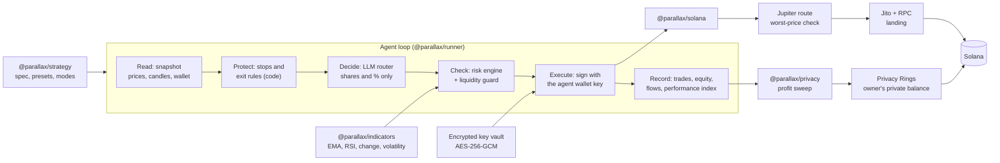

# Parallax

Parallax runs AI trading agents on Solana. A person describes a strategy or picks a preset; an AI model proposes trades;
a deterministic risk engine decides what may actually happen; the agent's own wallet signs a Jupiter swap that is sent
through Jito and RPC; every trade and every equity snapshot is recorded. Private mode moves an agent's realized profit
into its owner's private balance (Solana Privacy Rings by Helius), so the link between the agent and the owner's main
wallet is not visible on chain. This repository is the open-source core of Parallax: the agent loop, the risk rules,
the Solana trading code and the privacy code. It is software, not financial advice, and it makes no promise of profit.

- Website: <https://parallaxtrade.xyz>
- X: <https://x.com/parallax_trade>

## How an agent works

Every tick (15 s by default) the runner walks every running agent through the same steps:

1. **Read.** Prices, candles and the agent wallet's balances (USDC, tokens, SOL for fees). Deposits and withdrawals
   are told apart from trading results, so the agent's return is time-weighted and a top-up is never "profit".
2. **Protect.** Stop-loss, take-profit, trailing stops and preset exit rules are checked by code on every tick and sell
   at once, without asking the AI.
3. **Decide.** When a decision is due and something changed (a price move, a schedule, a level near a stop), the model
   gets a prompt with shares and percentages only (no wallet address, no dollar amounts) and answers with JSON.
4. **Check.** The risk engine accepts or rejects each action against the agent's hard limits and the preset's rules,
   then the liquidity guard checks the order against the book (spread, depth, price impact, 24h volume).
5. **Route.** Jupiter builds the best route over the Solana DEXs. The route's worst case (minimum output after
   slippage) must be at or better than the order's limit price, or nothing is signed.
6. **Land.** The agent wallet signs the transaction; it goes out through Jito (with a tip) and RPC at the same time,
   and the real amounts are read back from the confirmed transaction.
7. **Record.** The fill becomes a trade row with its reason; equity is snapshotted hourly with a performance index.

If the AI is unavailable, the agent holds for that tick (protect-only: no new buys, stops keep working). If the wallet
runs out of SOL for fees, the agent pauses itself, still lets protective sells out, and resumes once topped up.

## Architecture



## Packages

| Package                                       | What it does                                                                                                                                                                                                                             |
| --------------------------------------------- | ---------------------------------------------------------------------------------------------------------------------------------------------------------------------------------------------------------------------------------------- |
| [`@parallax/strategy`](packages/strategy)     | The strategy spec (zod schema), its canonical hash, the five built-in presets (DCA, Protect, Trend, Rebalance, Momentum), agent modes (tokenized stocks or crypto), validation and human-readable units.                                 |
| [`@parallax/indicators`](packages/indicators) | Pure indicators computed from candles: EMA, RSI, price change, volatility.                                                                                                                                                               |
| [`@parallax/exchange`](packages/exchange)     | The venue-neutral interface the runner trades through: markets, books, balances, orders, and directional price/size rounding.                                                                                                            |
| [`@parallax/risk`](packages/risk)             | The deterministic risk engine, the order-book liquidity guard, protective stops and preset rules (buy conditions, exit rules, rebalancing plans).                                                                                        |
| [`@parallax/runner`](packages/runner)         | The agent loop: snapshot, protective stops, LLM prompt and routing, risk checks, execution, gas checks, capital ledger, deposit/withdrawal (flow) accounting with a time-weighted index, encrypted key vault, in-memory store.           |
| [`@parallax/solana`](packages/solana)         | The Solana venue: Jupiter swaps with worst-price checks, Jito + RPC landing, the market list (majors, tokenized stocks, safe trending tokens), candles, per-agent wallets, withdraw-to-owner, Privacy Rings deposits.                    |
| [`@parallax/privacy`](packages/privacy)       | Private mode: profit sweeps to the owner's private balance, the browser client of the private balance (key derived from one wallet signature, deposit wallet, withdrawals), and the public-view scrubbing that hides amounts and owners. |

Dependencies point one way: `strategy` ← `indicators`, `exchange` ← `risk` ← `runner`; `solana` implements the
`exchange` interface; `privacy` builds on `runner` and `solana`.

## Privacy model

What is public on Solana, and what Parallax keeps hidden:

| Public on chain                                                      | Hidden                                                                                                                                                                           |
| -------------------------------------------------------------------- | -------------------------------------------------------------------------------------------------------------------------------------------------------------------------------- |
| The agent wallet and its swaps (every Solana transaction is public). | Which owner an agent wallet belongs to, once profit leaves through Private mode instead of a transfer to the owner's wallet.                                                     |
| Deposits into Privacy Rings from the agent wallet (amount and time). | The owner's private balance, and who withdraws from it to where.                                                                                                                 |
|                                                                      | In public views: owners, wallets, dollar equity, trade sizes, order ids, transaction signatures and dollar figures inside reasons (`scrubAmounts`). Returns are shown in % only. |

- **Key derived in the browser.** The owner's private balance key is `sha256(signMessage("Parallax private balance v1"))`:
  one wallet signature, deterministic, never stored or sent. Only the public shielded address leaves the browser. A
  second, domain-separated key from the same signature is a plain "deposit wallet" that signs private deposits and pays
  withdrawal fees, because common wallets cannot sign the SDK's v1 transactions.
- **Sweep.** With Private mode on, realized profit from the agent's own trades since it was turned on (minus what was
  already swept; losses must be made up first) is deposited in USDC from the agent wallet straight into the owner's
  shielded address, once it reaches a minimum. A failed deposit is retried; trading never waits for it. The swept total
  is added back to the agent's performance equity, so a sweep is not a loss.
- **Timing.** A deposit and a withdrawal of the same amount moments apart can be matched by anyone. The browser client
  warns about that (`timingRisk`) and suggests round amounts.

## Risk rules

Enforced by code on every action, whatever the model says:

- Only the agent's markets (or the liquid shortlist in "all pairs" mode); buys only on open, enabled markets.
- Per-trade size (`maxTradeBps`), per-token position (`maxPositionBps`), trades per day, run time.
- Daily loss limit on the time-weighted index: past it, no new buys until the next UTC day (a deposit cannot hide a
  loss, a withdrawal is not one).
- Preset rules: buy intervals and budgets, buy-below prices, indicator entry conditions, maximum open positions,
  rebalancing targets that may not be overshot.
- Minimum order size, with lot rounding; limit prices within the slippage band (1% by default), rounded to the safe
  side.
- Liquidity guard on every order: 24h volume, spread, share of daily volume, book depth and price impact. Protective
  sells are never blocked, only clipped to what fills within the band.
- Protective stops and exit rules sell by code, are not counted against the daily trade limit and work in protect-only
  mode.
- Gas: a swap is not attempted without the SOL to pay for it at worst; an empty wallet pauses buying.

## Quick start

Requirements: Node.js 22 or newer.

```sh
npm ci
npm run build
npm test
npm run lint
npm run examples   # runs the three scripts below (after the build)
```

The examples need no keys and touch no network:

- `examples/validate-spec.mjs` builds a strategy from a preset, validates it and prints its `specHash`.
- `examples/risk-engine.mjs` passes a model decision through the risk engine and the liquidity guard.
- `examples/paper-agent.mjs` runs one agent on a paper exchange: a decision, a refused oversized buy, a filled buy,
  then a stop-loss sell by code after a price drop.

To trade for real you wire `SolanaExchange` (`@parallax/solana`), a `RunnerStore` on your database, an
`EncryptedKeyVault` with your master key and an `LlmRouter` with your model endpoints into a `Runner`, and call
`runner.start()`.

## Configuration

Environment variables read by the exported code (names only; every one has a default unless marked required):

| Area                 | Variables                                                                                                                                                                                                                                                                  |
| -------------------- | -------------------------------------------------------------------------------------------------------------------------------------------------------------------------------------------------------------------------------------------------------------------------- |
| Runner               | `RUNNER_TICK_SEC`, `EPOCH_SEC`, `TRIGGER_MOVE_PCT`, `TRIGGER_HEARTBEAT_SEC`, `DRY_RUN`, `ALL_MODE_SHORTLIST`                                                                                                                                                               |
| Limits and liquidity | `MAX_SLIPPAGE_BPS`, `MIN_ORDER_USD`, `MAX_DISTINCT_POSITIONS`, `MAX_SPREAD_BPS`, `MAX_ORDER_PCT_OF_DAY_VOLUME`, `MIN_MARKET_DAY_VOLUME_USD`, `LIQUID_DAY_VOLUME_USD`, `BOOK_BUFFER_BPS`, `MARKETS_SYNC_SEC`                                                                |
| AI models            | `LLM_BASE_URL` and `LLM_API_KEY` (any OpenAI-compatible endpoint), `LLM_PROVIDER_NAME`, `LLM_TIMEOUT_MS`, `LLM_FALLBACK_BASE_URL`, `LLM_FALLBACK_API_KEY`, `LLM_FALLBACK_MODEL`, `SURPLUS_API_KEY`, `SURPLUS_BASE_URL`, `SURPLUS_PIN_PROVIDER`, `SURPLUS_MAX_PRICE_PER_1M` |
| Solana               | `SOLANA_RPC_URL`, `JUPITER_API_URL`, `JUPITER_API_KEY`, `JUPITER_GAP_MS`, `JITO_URL`, `JITO_AUTH`, `JITO_TIP_LAMPORTS`, `JITO_MAX_TIP_LAMPORTS`, `GECKO_API_URL`, `SOLANA_SLIPPAGE_BPS`, `SOLANA_GAS_RESERVE_SOL`, `SOLANA_CONFIRM_TIMEOUT_MS`                             |
| Private mode         | `PRIVATE_MODE` (`on` to enable), `SPR_NETWORK` (`devnet` or `mainnet`), `HELIUS_API_KEY`, `SPR_INDEXER_URL`, `SPR_PROVER_URL`, `PRIVATE_MIN_SWEEP_USDC`, `PRIVATE_PRIORITY_FEE_LAMPORTS`                                                                                   |

The key vault takes a 32-byte master key (hex) from your process; keep it in a secret store, never in the repository.

## Security notes

- **Agent keys are held by whoever runs the runner.** Every agent has its own wallet; its secret key is stored
  encrypted at rest (AES-256-GCM, bound to the wallet address) and decrypted only for the duration of a signature. A
  compromise of the machine and its master key exposes the agent wallets, so fund agents with amounts you can afford
  to lose.
- **Limits are enforced in code, not on chain.** The risk engine, the gas checks and the worst-price check run before
  anything is signed; nothing on Solana prevents a modified runner from doing otherwise.
- **Where money can go.** Besides swaps through Jupiter, the wallet code can only send an agent's funds back to its
  owner (`withdrawAllToOwner`) or into the owner's private balance (Private mode).
- **The privacy SDK is alpha.** `@heliuslabs/spr` is pinned to a fixed version; review it before relying on it.
- Report vulnerabilities privately, see [SECURITY.md](SECURITY.md).

## Contributing and license

See [CONTRIBUTING.md](CONTRIBUTING.md) and [CODE_OF_CONDUCT.md](CODE_OF_CONDUCT.md).

Licensed under the [Apache License, Version 2.0](LICENSE). Copyright 2026 Parallax, see [NOTICE](NOTICE).
